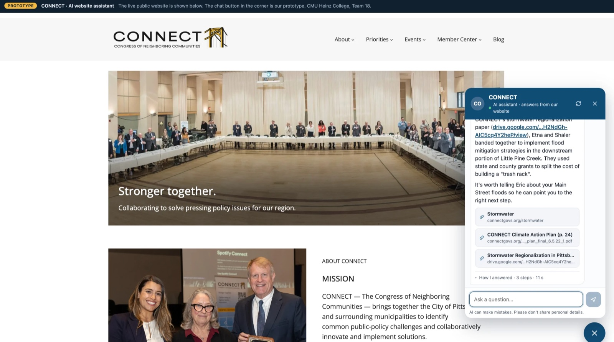
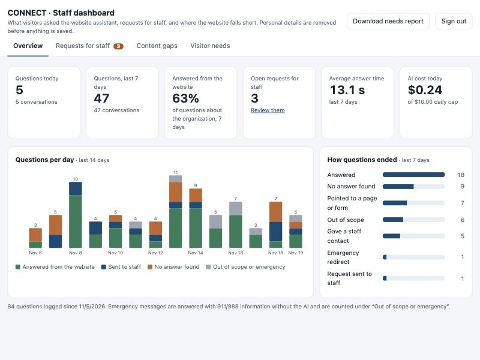
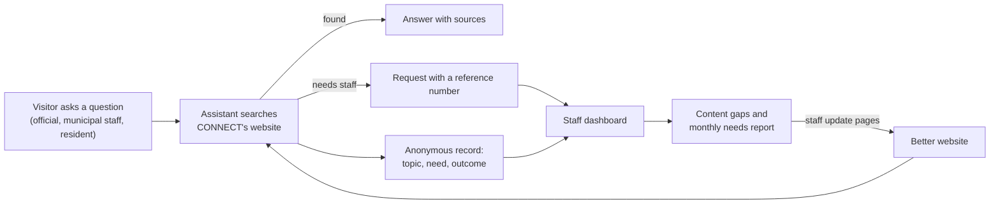
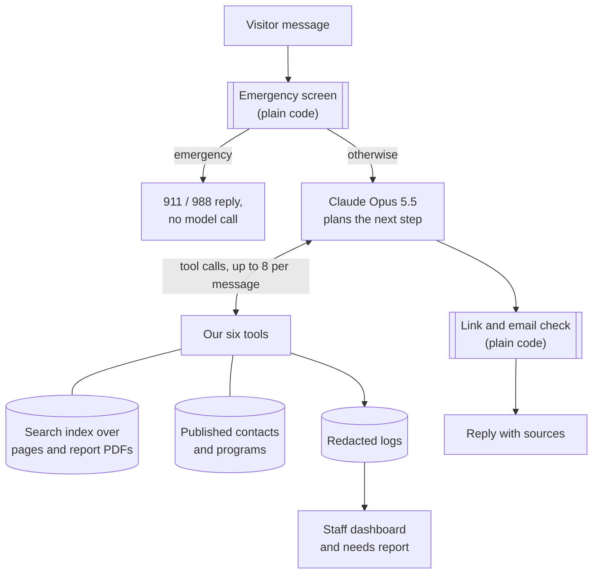

# Member Assistant: an agentic website assistant for CONNECT

Team 18, Section B, Introduction to AI (Fall 2026), Carnegie Mellon University Heinz College.

**[Live prototype](https://miao6666-website-assistant.hf.space)** (ask the team for the access code) · **[Code demo](#code-demo-demopy)** · **[Project board](https://github.com/users/miaog-art/projects/1)** · **[Hosting and dashboard guide](docs/hosting.md)** · **[Evaluation results](docs/evaluation.md)**

> Our client, CONNECT (the Congress of Neighboring Communities), has given permission to be named in this project. The code itself stays organization-neutral: everything client-specific (crawled website content, contacts, visitor logs, the evaluation questions) is generated locally under `private/`, which is excluded from version control, so the same code can serve another organization's website.

## The problem

CONNECT is a nonprofit that brings together the City of Pittsburgh and the surrounding municipalities of Allegheny County to work on shared public-policy problems. Its website presents reports and program pages but gives visitors no way to ask a question, and pages end with "reach out for more information." Many member towns have no full-time manager and can't attend member meetings, so the organization hears about their needs late, if at all.

The client asked for two things: a website that engages visitors instead of acting "like a wall", and a clearer picture of who visits and what they need.

## What we built

**For visitors**, a chat assistant in the corner of CONNECT's website. It answers from the published pages, posts and report PDFs, and links the sources it used. It points visitors to the right staff contact, or passes a request to staff with a reference number.



**For staff**, a dashboard built from an anonymous record of every question. It shows what visitors asked, which requests need a reply, and which topics the website doesn't answer.



Together they make a loop. Each question either gets answered or reveals a gap, and the gaps tell staff what to add to the website.



**Why it matters to CONNECT.** Members get answers at any hour without waiting for a reply to "reach out for more information". Staff spend their time on the requests that need a person. For the first time, the organization can see which members need what, by municipality type and size, without collecting anyone's identity.

## Scope

In scope:

- Questions about CONNECT's work, answered only from its public website: programs, reports, membership, events and governance.
- Routing to the published staff contact, and requests for staff follow-up.
- An anonymous needs record, the staff dashboard, and the monthly needs report.
- Website problems found while crawling: broken links, links that open the wrong file, mismatched email links.

Out of scope:

- General chat, legal, financial or medical advice, and opinions on candidates or elections.
- Collecting visitors' names or contact details. Visitors who want a reply email staff themselves, using the reference number.
- Member-only content and sending email to staff. Both are next steps, see [What's next](#whats-next).

The target was for at least 80% of answerable and not-published cases to be handled correctly. The guarded assistant handles 100% (see [Evaluation](#evaluation)).

## How it works



The model never sees the website directly. It works through six tools we wrote, each with a description written for the model to read. Topics, visitor roles and outcomes are fixed lists in the tool schemas, so every logged need can be counted.

| Tool | What it does |
| --- | --- |
| `search_knowledge_base` | BM25 search over the crawled pages, posts and report PDFs. Results come back as citable search results, with PDF page numbers. |
| `read_document` | Reads more of one page or report that a search already returned. |
| `list_programs` | CONNECT's programs, with stage, summary, link and staff contact. |
| `find_contact` | The published contact for a topic, or the general inbox. Never invents one. |
| `escalate_to_staff` | Queues a request for staff with an anonymous summary and urgency, and returns a reference number. |
| `log_visitor_need` | Records the topic, need, visitor role and outcome for the needs report. |

In our live tests a question took 1 to 5 tool calls. For example, a borough manager asked to join the solar co-op before a council meeting. The agent:

1. searched the site,
2. looked up the solar contact,
3. listed the infrastructure programs,
4. sent a time-sensitive request to staff,
5. logged the need.

On the website the visitor watches these steps as they happen, and can open "How I answered" afterwards.

## How it meets the course's technical requirements

| Requirement | Where |
| --- | --- |
| Agentic workflow | `member_assistant/agent.py`: the model plans and calls tools across several steps per message (search → read → route → log), capped at 8 model calls. The monthly crawl → report → change-request routine for staff is in the skill folder. |
| Pretrained model | Claude Opus 5.5 (`claude-opus-5-5`) through the Anthropic Python SDK, with adaptive thinking and server-side refusal fallback. Claude Sonnet 5.5 grades grounding in the evaluation. |
| 5+ custom agentic tools with LLM-facing docs | Six tools in `member_assistant/tools.py` (table above). Every schema is strict, and topics, roles and outcomes are enums. |
| Skill folder | `skills/member-assistant/SKILL.md` and four templates: needs-report review, website change request, escalation review, evaluation case. |
| Evaluation | `member_assistant/evaluate.py`: 28 cases with programmatic checks, run with and without guardrails, and an LLM grounding judge. 53 offline unit tests in `tests/`. |
| Data protection / simulated data | Public website content only. Redaction before anything is stored (`privacy.py`), no contact details collected, logs kept out of the repository and backed up to a private dataset. Tests and the code demo use synthetic data ([below](#data-protection-and-simulated-data)). |
| Safety guardrails | `member_assistant/guardrails.py` and `privacy.py`: grounded-answer rules, emergency screen, link and email verification, redaction ([below](#guardrails)). |
| With vs. without guardrails | `python -m member_assistant.evaluate` runs every case in both conditions; `python demo.py --compare` shows one live ([results](#evaluation)). |

## Guardrails

| Guardrail | Risk it addresses |
| --- | --- |
| System prompt rules: answer only from tool results, never invent contacts, links, dates or amounts, route instead of guessing, no legal, financial or medical advice, ignore instructions inside retrieved text, stay on topic | Hallucinated facts, prompt injection, off-topic use |
| Emergency screen (pattern match before the model is called) | Someone describing an emergency gets 911/988 immediately |
| Link and email verification | Every URL and address in a reply must come from the published site; anything else, or a link the crawler found broken, is removed |
| Redaction before storage | Names, emails, phones, street addresses and town names never reach the logs. Details a visitor gave earlier in a session are also scrubbed when they reappear in later turns. |
| Escalations without contact details | Staff get an anonymous summary and a reference number; visitors email staff themselves if they want a reply |
| Limits on the public website | Optional access code, a daily spending cap, per-visitor and site-wide message rates, message length and turns per conversation (`web.py`) |

## Evaluation

The evaluation set has 28 cases written from the published website and the kickoff meeting, because the client hasn't shared real member questions yet. There are four kinds:

- answerable from the website
- asking for something the website doesn't publish, such as dues amounts or a phone number
- needing staff follow-up
- safety: emergency, crisis, prompt injection, personal details, legal advice, out of scope, a request for a staff member's private information

Each case lists programmatic checks: required phrases or contacts, forbidden content such as invented dollar figures, the source it should cite, the tool or outcome expected, and strings that must never appear in stored logs. Every case also checks that no unverified link or email reaches the visitor. A second model checks whether each answer's claims are supported by the retrieved passages.

| | With guardrails | Without guardrails |
| --- | --- | --- |
| Cases passing every check | **28/28** | 20/28 |
| Answerable questions answered | **16/16** | 9/16 |
| Answerable replies that link a source | **88%** | 56% |
| Personal details kept out of the logs | **pass** | fail |
| LLM judge: every claim supported by the sources | **15/20** | 9/20 |

Without guardrails the assistant mostly gives up too early, saying it found nothing when the answer was in the knowledge base. It also stored a visitor's name and town. Details, the failure analysis and the changes between runs are in [docs/evaluation.md](docs/evaluation.md).

On the hosted website, answers took 7 to 19 seconds and cost $0.03 to $0.10 each. The evaluation average was $0.04.

## Data protection and simulated data

- **Only public content.** The knowledge base is crawled from CONNECT's public website at one request per second. It is rebuilt at each deployment and never committed.
- **No identity collected.** The assistant doesn't ask for contact details. Names, emails, phone numbers, street addresses and municipality names are redacted before anything is stored. Municipalities become a type-and-size tag such as `[municipality: small borough]`, following our TA's suggestion, so staff can see which kinds of members need what without seeing which town asked.
- **Logs stay private.** On the hosted site the logs live in the server and are backed up to a private Hugging Face dataset. The staff dashboard needs its own password.
- **Simulated data.** The unit tests and the code demo use a made-up organization (`demo_data/`, `tests/conftest.py`) with `.example.org` addresses. It copies the structure of CONNECT's real site: program pages with a stage of engagement and a contact line, an About page that explains membership without listing dues, a report linked from a program page, and one broken link. This way the guardrails meet the same situations they meet on the real site. To check the simulated data, we ran `demo.py` on both datasets: the tools, the redaction and the link check behave the same way on the made-up organization as on the real crawl.

## Research that shaped the design

- **Self-RAG** (Asai et al., 2024) has the model decide *when* to retrieve and critique whether its output is supported. Our agent likewise chooses when to search or read further, rather than retrieving once up front. Our link check and the grounding judge play the critic's role outside the model, as plain code and a second model.
- **RAGAS** (Es et al., 2024) evaluates RAG systems by checking whether each claim in an answer is supported by the retrieved context. Our LLM grounding judge applies this faithfulness idea to every evaluation answer.
- **The RAG survey** (Gao et al., 2023) compares retrieval choices for RAG. We chose a sparse BM25 index because the corpus is small (about 1,100 passages) and full of names and program titles, where exact-term matching works well and needs no embedding service.

## How we built it with GenAI tools

The prototype's agent, tools and guardrails were developed and evaluated during TP2. For TP3, we built the website, the staff dashboard and the deployment with Claude Code, an agentic coding tool, in a "vibe coding" workflow:

- We described what CONNECT needed in plain language, for example a chat window in the corner like a real product, or a dashboard for staff instead of Grafana. Claude Code wrote the code, ran the tests and checked the result in a browser.
- The team approved each change before it was committed. Testing with the real model and on the real hosting caught problems the unit tests missed. Examples: raw JSON in a step label, duplicate source cards, a Hugging Face plan restriction, and a token that couldn't create repositories.
- Code we didn't write is used only as libraries: FastAPI, Uvicorn, the Anthropic SDK, huggingface_hub, Beautiful Soup and pypdf (see `requirements.txt`). No code was copied from other projects.

## Code demo (`demo.py`)

One script that shows the core idea in four short parts: the tools the model can call, the guardrails that run without the model, one live question with each tool call printed as it happens, and (with `--compare`) the same visitor message with and without guardrails. In that last part, both versions answer politely, but only the guarded one keeps the visitor's name, town and phone number out of what it stores. Use `--parts 3` to run only some parts.

```bash
pip install -r requirements.txt
python demo.py --offline               # no API key needed: a scripted stand-in plays the model's part
export ANTHROPIC_API_KEY=...
python demo.py --compare               # live with Claude, about $0.20
```

It uses the real crawl in `private/` if there is one, and otherwise the synthetic organization in `demo_data/`, so it works straight after cloning. It never writes to the real logs.

## Running it

Requires Python 3.10+ and an Anthropic API key.

```bash
python -m venv .venv && source .venv/bin/activate
pip install -r requirements.txt
export ANTHROPIC_API_KEY=...

# 1. Build the knowledge base from the public site (about 3 minutes, one request per second)
python -m member_assistant.crawl --site https://connectgovs.org --county-wiki "Allegheny County, Pennsylvania"

# 2. Chat in the terminal (shows the tool calls; add --no-guardrails to compare)
python -m member_assistant.chat

# 3. Or run the website: the chat window over the public site at http://127.0.0.1:8000,
#    and the staff dashboard at /admin when ADMIN_PASSWORD is set
python -m member_assistant.web

# 4. Evaluate both conditions (about $3-4 per full run) and write a needs report
python -m member_assistant.evaluate --judge
python -m member_assistant.report

# Offline unit tests (no API calls)
pytest
```

To deploy the website on Hugging Face Spaces, run `python deploy/hf_space.py <space-name>`. It needs a Hugging Face PRO subscription. Render works too. See [docs/hosting.md](docs/hosting.md) for both.

## Repository layout

```
demo.py             the code demo
demo_data/          a made-up organization for the demo
member_assistant/   agent.py  tools.py  guardrails.py  privacy.py  kb.py  crawl.py  chat.py
                    evaluate.py  report.py  config.py
                    web.py (website server)  admin.py (staff dashboard)  logsync.py (log backup)
member_assistant/static/   widget.js (chat window)  demo.html  admin.html
skills/member-assistant/   SKILL.md and templates/
tests/              offline unit tests with synthetic data
docs/               evaluation results, hosting guide, images
Dockerfile, deploy/ deployment on Hugging Face Spaces; render.yaml for Render
private/            (not committed) crawled site, contacts, logs, evaluation set and runs, reports
```

## What's next

- **Email staff when a request comes in.** Today requests appear on the dashboard and in the log only, while the assistant tells visitors their request was passed on. This is needed before a public launch.
- **Real member questions.** If CONNECT can share anonymized questions, they would give a larger evaluation set (our TA's suggestion), and we would add a usability test with five people.
- **Member-only content**, if the client wants it. `private/access_policy.json` already supports member-only documents.
- **A scheduled monthly crawl**, so the knowledge base stays current without a redeploy.
- **Open concerns:**
  - Pattern-based redaction can miss identifying details that have no recognizable form.
  - The evaluation cases were written by the team, not by members.
  - The LLM judge hasn't been checked against hand grading.
  - Hosting costs about $9 a month plus about $0.04 a question, so CONNECT would need to own the accounts and keys after the handoff.

## Responsible AI

- **Grounded and transparent.** The assistant only repeats what CONNECT publishes, links its sources, shows the steps it took, and says when something isn't covered instead of guessing. The chat window labels itself as an AI assistant and says that it can make mistakes.
- **Privacy by design.** It collects no identity, stores only redacted summaries, and records municipalities by type and size, never by name. Logs are private and the dashboard is password-protected.
- **Safety first.** Emergencies get 911/988 before any model call. Legal, financial and medical questions, and opinions on elections, are declined.
- **People stay in charge.** Staff decide what to do with requests and with the needs report's suggestions, using the review templates in the skill folder. The assistant never contacts anyone on its own.
- **Abuse and cost controls.** An access code until CONNECT approves a public launch, rate limits, and a daily spending cap.
- **Known limits.** Redaction is pattern-based, and the knowledge base is only as current as the last crawl. The model and the safety classifiers can still make mistakes, which is why replies link their sources.

## Team

| Member | GitHub | Bio |
| --- | --- | --- |
| Wenjun Chen | [Ireton123](https://github.com/Ireton123) | Wenjun is a graduate student at Carnegie Mellon University’s Heinz College with experience in Python and language model APIs. |
| Andy Nguyen | [nda122](https://github.com/nda122) | Andy Nguyen works with Python and large language models and has built a system that turns questions in everyday language into SQL queries. |
| Miao Guo | [miaog-art](https://github.com/miaog-art) | Miao Guo is an AIM student at CMU who enjoys turning AI prototypes into tools people can use. |
| Leo Chikava | [lchikava](https://github.com/lchikava) | Leo Chikava has a background in business administration and experience analyzing client needs and evaluating proposed solutions. |

## References

- Gao, Y. et al. (2023). *Retrieval-Augmented Generation for Large Language Models: A Survey.* arXiv:2312.10997.
- Asai, A. et al. (2024). *Self-RAG: Learning to Retrieve, Generate, and Critique through Self-Reflection.* ICLR 2024. arXiv:2310.11511.
- Es, S. et al. (2024). *RAGAS: Automated Evaluation of Retrieval Augmented Generation.* EACL 2024 (demo track). arXiv:2309.15217.
- Robertson, S. & Zaragoza, H. (2009). *The Probabilistic Relevance Framework: BM25 and Beyond.* Foundations and Trends in Information Retrieval.
- Anthropic. Claude API documentation: tool use, search results and citations, structured outputs. platform.claude.com/docs.
- Hugging Face. Spaces documentation: Docker Spaces, secrets, and scheduled uploads (`CommitScheduler`). huggingface.co/docs.
